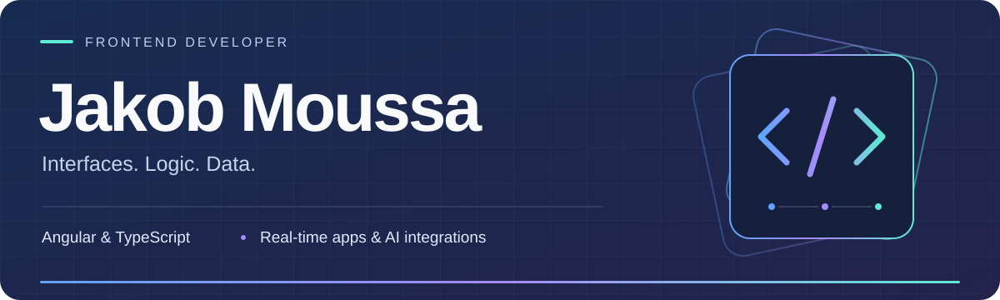
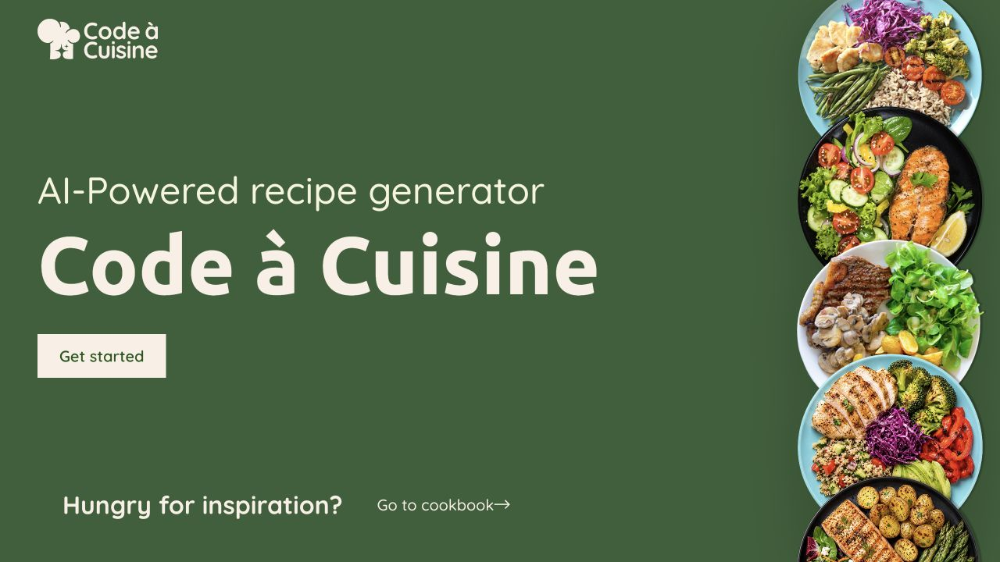
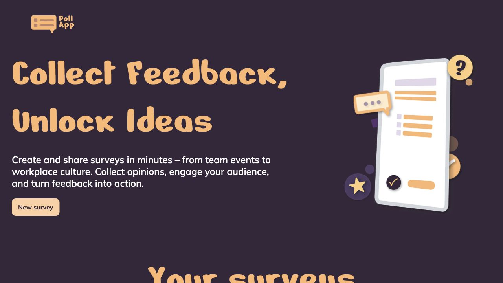
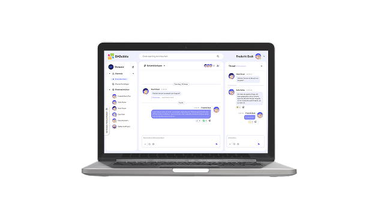
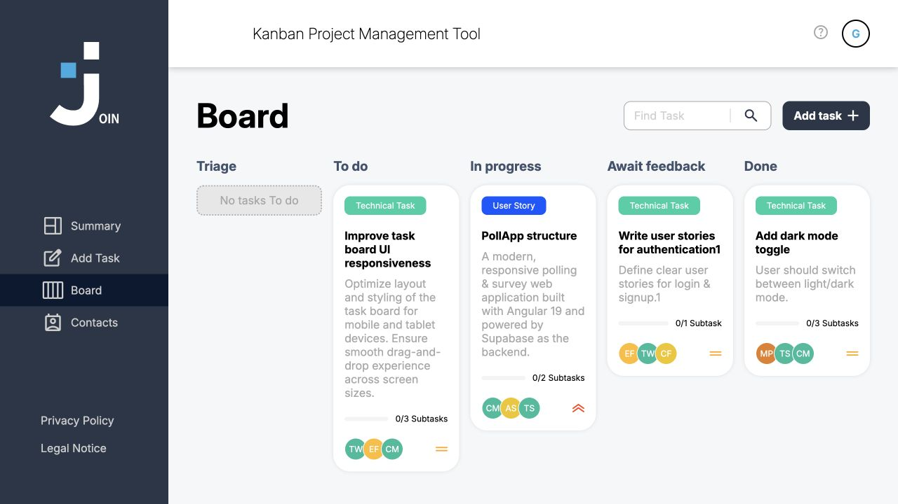
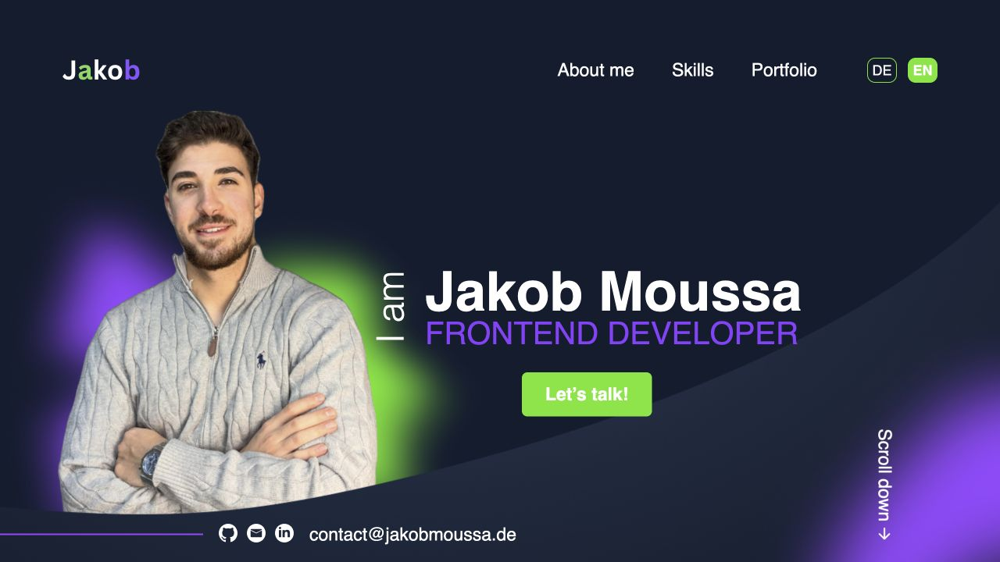

<picture>
  <source media="(prefers-color-scheme: dark)" srcset="assets/header-dark.svg">
  
</picture>

# Frontend Developer

**Angular & TypeScript · Real-time Applications & AI Integrations · Germany**

I'm Jakob. I enjoy the point where **UI, application logic and data come together** — whether that's a live survey, a team conversation or a recipe generated from the ingredients you have.

My path into software development is a career change. Practical projects have taught me to turn ideas into usable interfaces, connect frontends to backend services and work through technical challenges. I'm looking for a frontend role where I can contribute, learn from an experienced team and keep growing.

**Explore:** [Projects](#selected-projects) · [Technologies](#technologies-in-context) · [Let's connect](#lets-connect)

## Selected projects

### 01 / Code à Cuisine

**From ingredients to personalized recipes.** An Angular frontend connected to an n8n workflow and Google Gemini.

  
  
  
  

- Shared application state with Angular Signals.
- HTTP integration, response validation and explicit loading and error states.
- Recipe generation is handled through n8n; Gemini credentials stay outside the frontend.

 

---

### 02 / PollApp

**Collect opinions and turn them into results.** A responsive survey application with Angular and Supabase.

  
  
  
  

- Survey creation, voting, results and category filtering.
- Supabase data persistence and real-time updates.
- Feature-based Angular structure with shared services.

 

---

### 03 / DABubble

**Team conversations, connected.** A Slack-inspired messaging application with channels, direct messages and threads.

Existing project preview from my portfolio repository.

  
  
  
  

- Firestore-backed message streams exposed as RxJS observables.
- Channels, direct conversations, thread replies and reactions.

---

### 04 / Dialogue

**A chatbot builder with its own knowledge base.** A self-hosted project with a management dashboard and an embeddable website widget.

  
  
  
  
  
  

- Dashboard flows for workspaces, knowledge sources and widget configuration.
- A separate worker processes knowledge sources.
- The repository includes Vitest and Playwright configurations and tests.

---

### 05 / Join

**From to-do to done.** A collaborative Kanban project built with JavaScript, HTML, CSS and Firebase.

  
  
  
  

- Drag-and-drop task management, search and subtask progress.
- Firebase-backed persistence and a guest entry point for exploring the application.

 

---

### 06 / Portfolio

**A personal home for my work.** A frontend portfolio built with HTML, CSS and JavaScript.

Screenshot of the unchanged portfolio repository, rendered locally.

  
  
  

- Responsive project presentation and reusable JavaScript templates.
- German/English language switching and client-side contact-form validation.

## Technologies in context

**My focus:** Angular, TypeScript, responsive interfaces, application state and API integration. The other tools below reflect specific projects and their tooling, rather than equal depth in every technology.

### Frontend Development

Core frontend work:

  
  
  
  
  
  
  

Additional project experience through Dialogue:

  
  

### Backend & Database

Firebase and Supabase integrations in frontend projects; PostgreSQL and Prisma in Dialogue.

  
  
  
  

### AI & Automation

Recipe-generation workflow in Code à Cuisine:

  
  

### Development & Testing

Git and GitHub for version control. Docker in Dialogue, Vite in Memory, and VS Code configuration in my repositories. Playwright and Vitest are present in project tooling; I'm continuing to deepen my testing practice.

  
  
  
  
  
  
  

## What I care about

- Interfaces that are easy to use across devices.
- Readable code and clear boundaries between UI, state and data.
- Thoughtful handling of loading states, errors and user interactions.
- Understanding why a solution works, not just getting it to run.

I'm currently deepening my understanding of Angular architecture, automated testing and accessibility.

## Let's connect

**Open to frontend development opportunities in Germany.** I'd be happy to walk through my projects, discuss technical decisions and share what I've learned along the way.

[LinkedIn](https://www.linkedin.com/in/jakob-moussa/) · [GitHub](https://github.com/JakobMoussa) · [Portfolio repository](https://github.com/JakobMoussa/portfolio)

Banner, badges and icons are stored in this repository. [Visual sources and credits](assets/SOURCES.md).
